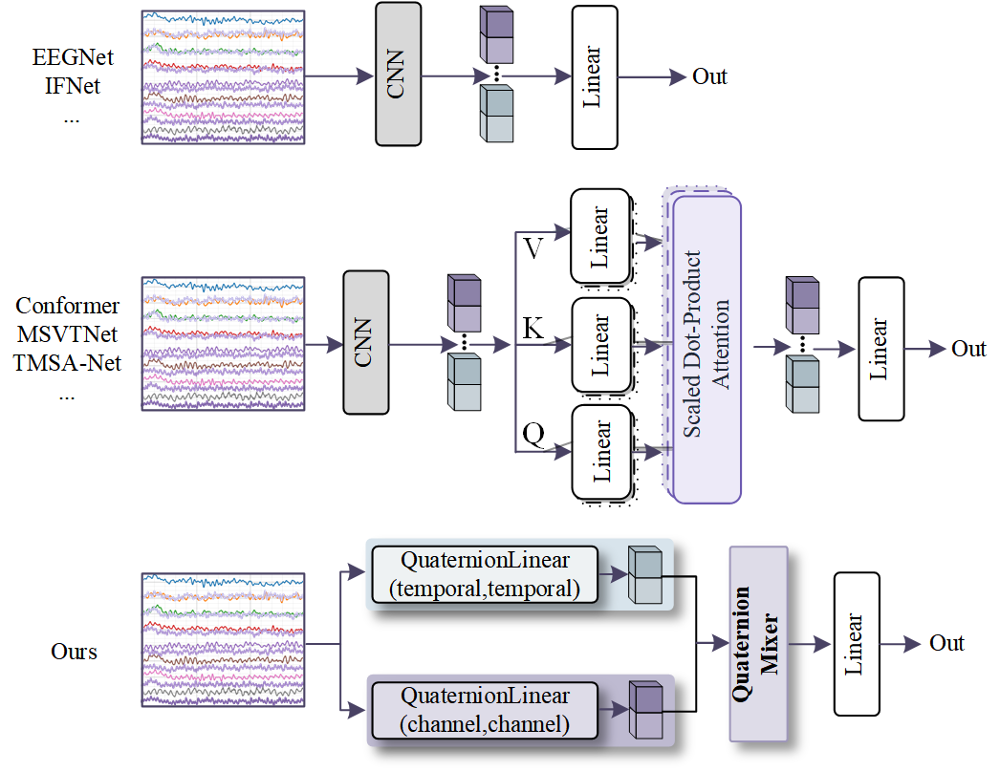

# Q-Mixer

Code for *Q-Mixer: A Quaternion Spatiotemporal Mixer for cross-subject EEG-based recognition*.



## Released experiments

The repository contains four motor-imagery training entry points. SEED-series
and JSED training code is not included.

| Directory | Dataset | Subjects | Input per trial |
| --- | --- | ---: | --- |
| `BCI_14_7513_sota` | BNCI2014002 | 14 | `5 x 120` |
| `BCI_2a9_7922_sota` | BNCI2014001 | 9 | `5 x 253` |
| `BCI_IVNO7_8293_sota` | Blankertz2007 | 7 | `1 x 1770` |
| `BCI_IVA5_8479_sota` | MI5, an additional five-subject experiment | 5 | `1 x 7021` |

Inputs are precomputed tangent-space features, arranged as time windows by
feature dimensions. File names and MAT fields are listed in
[Data preparation](DATASET_AND_PREPROCESSING.md).

## Run

Install PyTorch, NumPy, SciPy, scikit-learn, h5py, pyRiemann, Matplotlib, and
Pillow. The smoke tests were run with Python 3.11.

```bash
git clone https://github.com/liuyici/Q-Mixer.git
cd Q-Mixer/BCI_2a9_7922_sota
python main.py --file_path /path/to/features --device auto --seed 1 --num_seeds 5
```

Each fold holds out one subject, trains on the remaining subjects, and uses
unlabeled target features for adaptation. The default run covers all subjects
and seeds 1-5. Results are written to `snapshot.txt` in the working directory.
F1 is weighted; AUC is computed from class probabilities.

## Configuration

[PAPER_CONFIG.json](PAPER_CONFIG.json) records the public entry-point defaults.
The current implementation differs from the manuscript in its branch layers,
fusion projections, classifier, and training schedule. These differences are
listed in [Implementation notes](REPRODUCIBILITY.md).

Count model and domain-discriminator parameters from the repository root:

```bash
python tools/count_parameters.py
```

The manuscript's 22.6K parameter count refers to the separate JSED model, not
these MI configurations.

## Tests

```bash
python -m pip install pytest
python -m pytest tests -q
```

## Acknowledgments

The quaternion layers are based on Titouan Parcollet's `pytorch-qnn`.
The covariance-alignment utility retains its original MEKT attribution.
